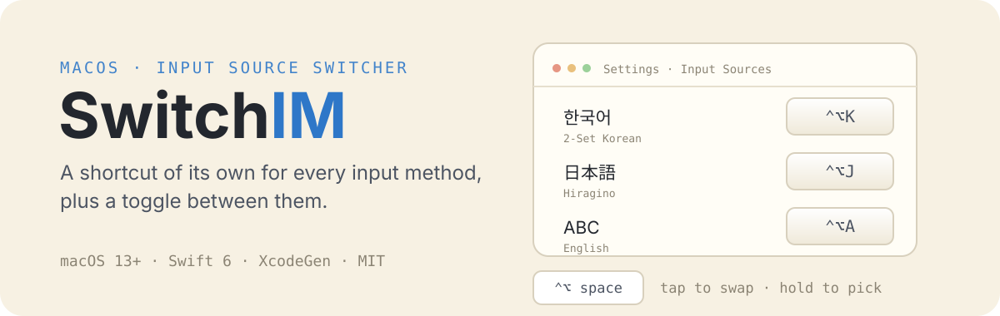
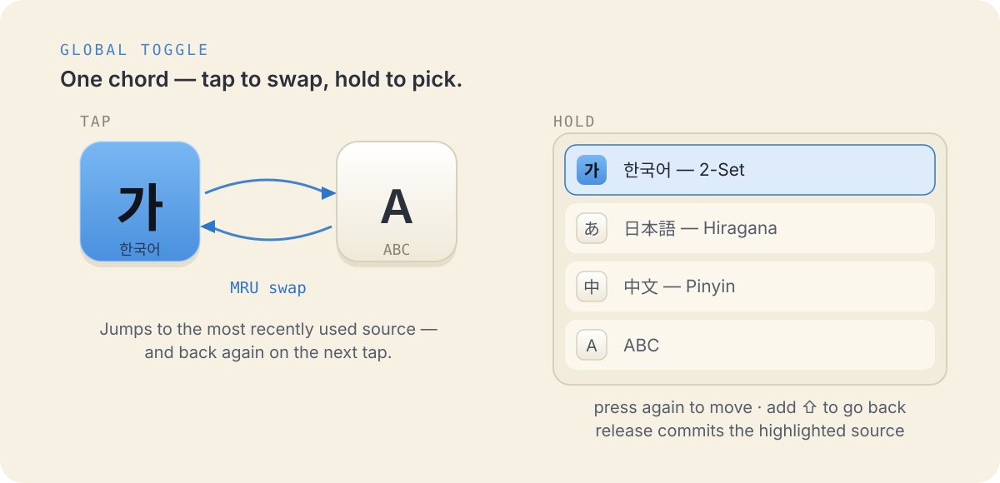
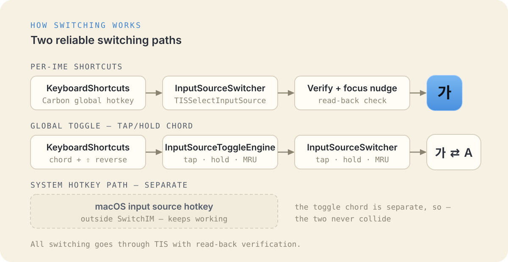

<p align="center">
  
</p>

# SwitchIM

[English](README.md) · [한국어](README.ko.md) · [日本語](README.ja.md) · [简体中文](README.zh-Hans.md)

**SwitchIM** は、macOS の各入力ソースに専用のグローバルショートカットを割り当てます。
入力ソース切り替えトグルを設定すると、システムの入力ソース選択画面のように、一覧から
選んで切り替えられます。

## 入力ソースごとのショートカット

設定ウィンドウで入力ソースにショートカットを登録しておくと、どこからでもそのキーで
対象の入力ソースへ直接切り替えられます。

- サードパーティ IME（Keyman、Gureum、azooKey など）にも対応
- CJK（韓国語 / 日本語 / 中国語）入力メソッドを安定して切り替え
- すべての入力ソースはメニューバーからもワンクリックで選択可能

## 入力ソース切り替えトグル

<p align="center">
  
</p>

- 切り替えショートカットを押すと、前の入力ソースと現在の入力ソースの間をすばやく切り替え
- 修飾キーを**長押し**すると、画面中央にすべての入力ソースの一覧表示。
  ショートカットキーをもう一度押すと強調表示が次の項目へ移動し、
  Shift を組み合わせると逆方向へ戻り。修飾キーを離すと選択が確定

## その他

- 旧 SwitchIM 1.x ショートカットの移行を実施（1 回）
- ログイン時に起動するかを選択可能

## 切り替えの仕組み

<p align="center">
  
</p>

- 入力ソースごとのショートカットとトグルショートカットの登録は
  [KeyboardShortcuts](https://github.com/sindresorhus/KeyboardShortcuts) を利用
- 入力ソースの切り替えは TIS を利用

## ビルド

macOS 13 以降、Xcode 15 以降、[XcodeGen](https://github.com/yonaskolb/XcodeGen)
（プロジェクトファイル生成）、[SwiftLint](https://github.com/realm/SwiftLint)
（`brew install swiftlint`）が必要です。

ビルドは lint + format のビルド前フェーズを経由し、SwiftLint のエラーがあると
失敗します。[swift-format](https://github.com/swiftlang/swift-format) は Xcode に
同梱されています。

```
xcodegen generate
open SwitchIM.xcodeproj
```

`SwitchIM` スキームで `xcodebuild` を実行するか、プロジェクトを開いて Xcode で
ビルドします。

## 開発

### コアパッケージのテスト

エンジン（`SwitchIMCore`）は独自のユニットテストを持つ Swift パッケージです:

```
cd SwitchIMCore && swift test
```

ハードウェアが必要なテスト（実際の TIS / システム入力ソース）は、マーカーファイルが
あるときに実行されます。

```
touch /tmp/switchim_hw_tests && cd SwitchIMCore && swift test && rm /tmp/switchim_hw_tests
```

## ライセンス

SwitchIM は MIT ライセンスで公開されています。
