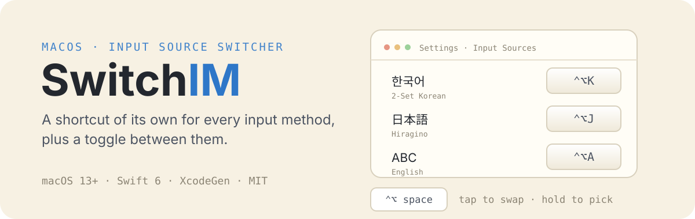
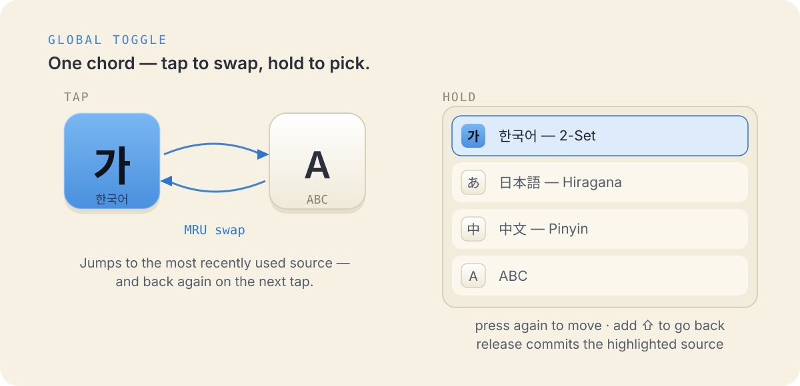
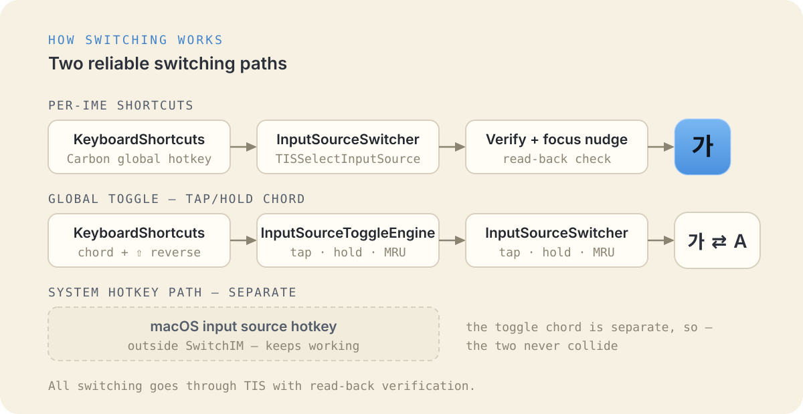

<p align="center">
  
</p>

# SwitchIM

[English](README.md) · [한국어](README.ko.md) · [日本語](README.ja.md) · [简体中文](README.zh-Hans.md)

**SwitchIM**은 macOS의 각 입력 소스에 전용 전역 단축키를 지정합니다. 입력 소스 전환 토글을 설정하면 시스템 입력 소스 선택창처럼 목록에서 골라서 입력 소스를 바꿀 수 있습니다.

## 입력 소스별 단축키

설정 창에서 입력 소스에 단축키를 등록해 두면 어디서든 단축키로 해당 입력 소스로 바로 전환할 수 있습니다.

- 서드파티 IME(Keyman, Gureum, azooKey 등)도 지원
- CJK(한국어/일본어/중국어) 입력 소스를 안정적으로 전환
- 모든 입력 소스는 메뉴바에서도 클릭 한 번에 선택 가능

## 입력 소스 전환 토글

<p align="center">
  
</p>

- 입력 소스 전환 단축키를 누르면 이전 입력 소스와 현재 입력 소스 간 빠르게 전환
- 보조 키를 **길게 누르면** 모든 입력 소스 목록이 화면 중앙에 표시
- 단축키를 다시 누르면 강조 표시가 다음 항목으로 이동, Shift를 함께 누르면 반대 방향으로 이동.
  보조 키를 놓으면 선택이 확정됨

## 기타

- 기존 SwitchIM 1.x 단축키 마이그레이션 실시(1회)
- 로그인 시 실행 여부 선택 가능

## 전환 방식

<p align="center">
  
</p>

- 입력 소스별 단축키와 토글 단축키 등록은 [KeyboardShortcuts](https://github.com/sindresorhus/KeyboardShortcuts) 이용
- 입력 소스 전환은 TIS 이용

## 빌드

macOS 13+, Xcode 15+, [XcodeGen](https://github.com/yonaskolb/XcodeGen)(프로젝트 파일 생성), [SwiftLint](https://github.com/realm/SwiftLint)(`brew install swiftlint`)가 필요합니다.

빌드는 lint + format 사전 단계를 거치고, SwiftLint 오류가 있으면 실패합니다. [swift-format](https://github.com/swiftlang/swift-format)은 Xcode에 포함되어 있습니다.

```
xcodegen generate
open SwitchIM.xcodeproj
```

`SwitchIM` 스킴으로 `xcodebuild`를 실행하거나, 프로젝트를 열어 Xcode에서 빌드합니다.

## 개발

### 코어 패키지 테스트

엔진(`SwitchIMCore`)은 자체 유닛 테스트를 갖춘 Swift 패키지입니다:

```
cd SwitchIMCore && swift test
```

하드웨어가 필요한 테스트(실제 TIS / 시스템 입력 소스)는 마커 파일이 있을 때 실행됩니다.

```
touch /tmp/switchim_hw_tests && cd SwitchIMCore && swift test && rm /tmp/switchim_hw_tests
```

## 라이선스

SwitchIM은 MIT 라이선스로 배포됩니다.
