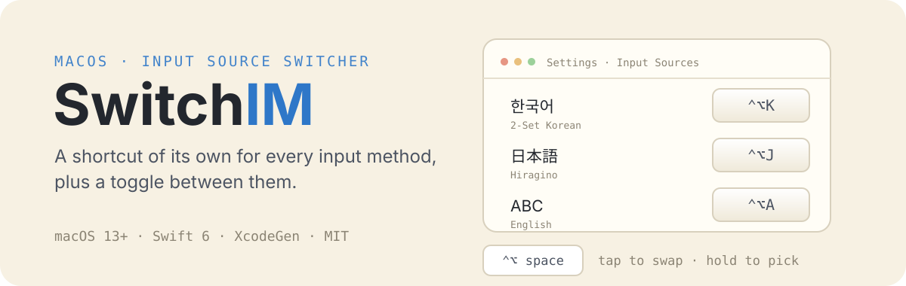
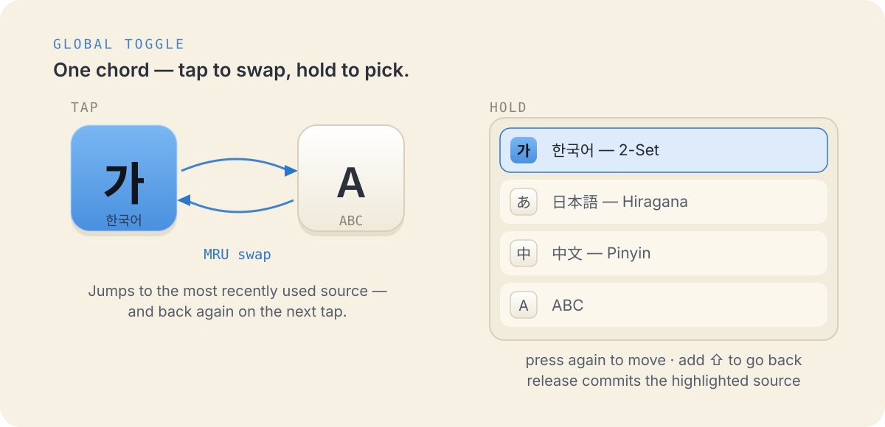
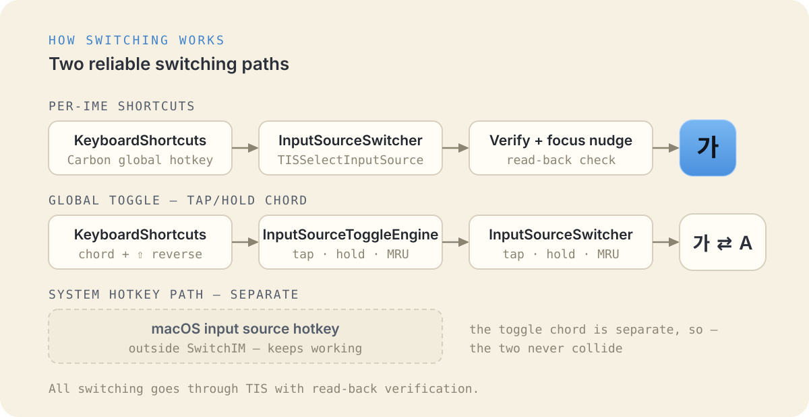

<p align="center">
  
</p>

# SwitchIM

[English](README.md) · [한국어](README.ko.md) · [日本語](README.ja.md) · [简体中文](README.zh-Hans.md)

**SwitchIM** assigns a dedicated global shortcut to every input source on macOS.
Set up the input source toggle and you can switch input sources from a list, much
like the system input source picker.

## Per-input-source shortcuts

Register a shortcut for an input source in the Settings window and you can
switch to that input source from anywhere with that key.

- Support for 3rd-party IMEs (Keyman, Gureum, azooKey, ...)
- Reliable switching for CJK (Korean/Japanese/Chinese) input methods
- Every input source also one click away in the menu bar

## The input source toggle

<p align="center">
  
</p>

- Press the toggle shortcut to switch quickly between the current and previous
  input source
- **Hold** the modifier keys: every input source appears in a centered list;
  pressing the shortcut key again moves the highlight to the next item, adding
  Shift goes back, and releasing the modifiers confirms the selection

## Also

- One-time migration of SwitchIM 1.x shortcuts
- Optional launch at login

## How switching works

<p align="center">
  
</p>

- Per-input-source shortcut and toggle registration uses
  [KeyboardShortcuts](https://github.com/sindresorhus/KeyboardShortcuts)
- Input source switching uses TIS

## Build

Requires macOS 13+, Xcode 15+ and [XcodeGen](https://github.com/yonaskolb/XcodeGen)
(project file generation), plus [SwiftLint](https://github.com/realm/SwiftLint)
(`brew install swiftlint`).

The build runs a lint + format pre-build phase and fails on SwiftLint errors.
[swift-format](https://github.com/swiftlang/swift-format) ships with Xcode.

```
xcodegen generate
open SwitchIM.xcodeproj
```

Run `xcodebuild` with the `SwitchIM` scheme, or open the project and build in
Xcode.

## Development

### Core package tests

The engine (`SwitchIMCore`) is a Swift package with its own unit tests:

```
cd SwitchIMCore && swift test
```

Hardware-gated tests (real TIS / system input sources) run when the marker
file exists:

```
touch /tmp/switchim_hw_tests && cd SwitchIMCore && swift test && rm /tmp/switchim_hw_tests
```

## License

SwitchIM is released under the MIT license.
