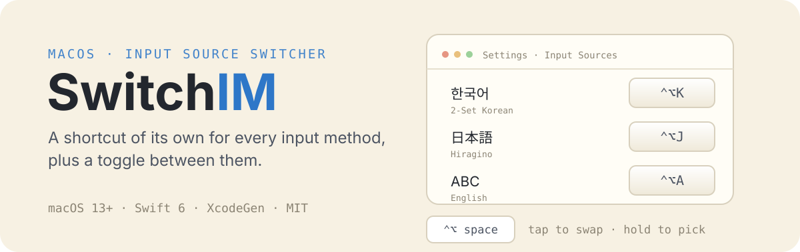
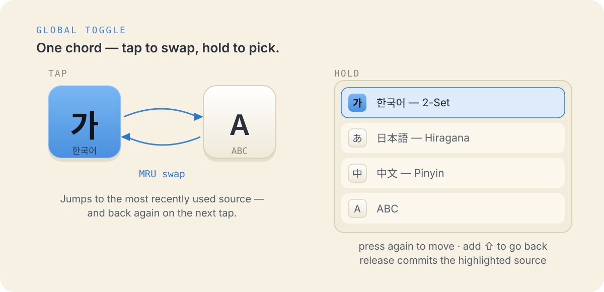
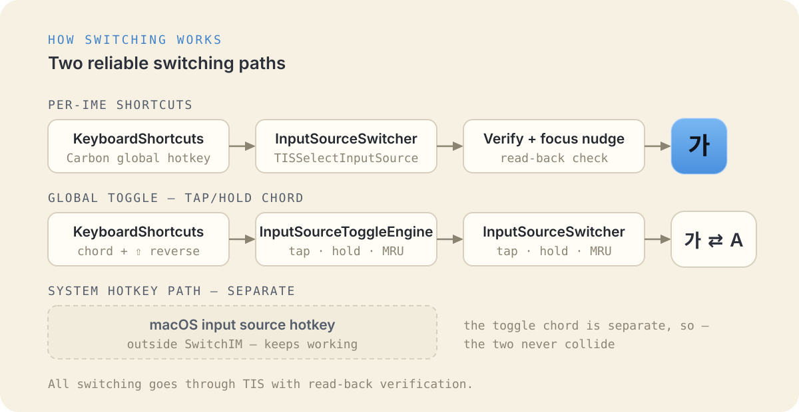

<p align="center">
  
</p>

# SwitchIM

[English](README.md) · [한국어](README.ko.md) · [日本語](README.ja.md) · [简体中文](README.zh-Hans.md)

**SwitchIM** 为 macOS 的每个输入源分配专属全局快捷键。设置输入源切换开关后，可以像
系统的输入源选择列表一样，从列表中挑选并切换。

## 各输入源的快捷键

在设置窗口为输入源注册快捷键后，随时随地按下即可直接切换到该输入源。

- 支持第三方输入法（Keyman、Gureum、azooKey 等）
- 稳定切换 CJK（韩语 / 日语 / 中文）输入法
- 所有输入源也可在菜单栏中一键选择

## 输入源切换开关

<p align="center">
  
</p>

- 按下输入源切换快捷键，可在当前输入源与上一个输入源之间快速切换
- **长按**修饰键时，所有输入源列表会显示在屏幕中央；再按一次快捷键，高亮移到
  下一项，配合 Shift 则反向移动。松开修饰键即确认选择

## 其他

- 一次性迁移旧版 SwitchIM 1.x 快捷键
- 可选择是否登录时启动

## 切换原理

<p align="center">
  
</p>

- 各输入源快捷键与切换快捷键的注册使用
  [KeyboardShortcuts](https://github.com/sindresorhus/KeyboardShortcuts)
- 输入源切换使用 TIS

## 构建

需要 macOS 13+、Xcode 15+、[XcodeGen](https://github.com/yonaskolb/XcodeGen)
（生成项目文件）和 [SwiftLint](https://github.com/realm/SwiftLint)
（`brew install swiftlint`）。

构建会先经过 lint + format 预构建阶段，出现 SwiftLint 错误即失败。
[swift-format](https://github.com/swiftlang/swift-format) 随 Xcode 提供。

```
xcodegen generate
open SwitchIM.xcodeproj
```

使用 `SwitchIM` scheme 运行 `xcodebuild`，或打开项目在 Xcode 中构建。

## 开发

### 核心包测试

引擎（`SwitchIMCore`）是一个自带单元测试的 Swift 包：

```
cd SwitchIMCore && swift test
```

需要硬件的测试（真实 TIS / 系统输入源）在标记文件存在时运行。

```
touch /tmp/switchim_hw_tests && cd SwitchIMCore && swift test && rm /tmp/switchim_hw_tests
```

## 许可证

SwitchIM 以 MIT 许可证发布。
